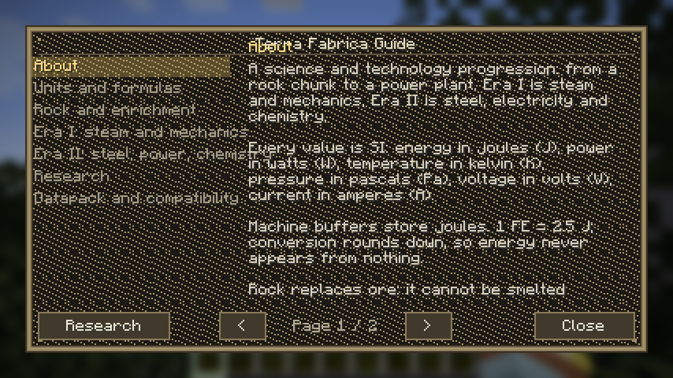
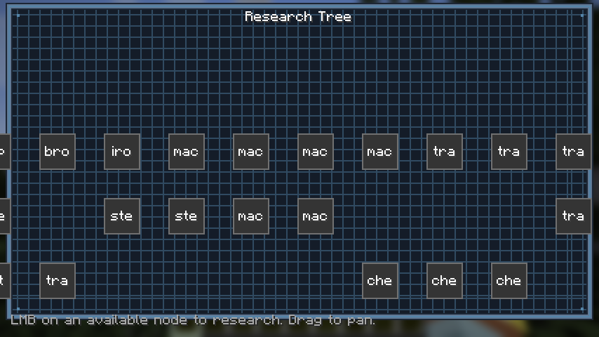
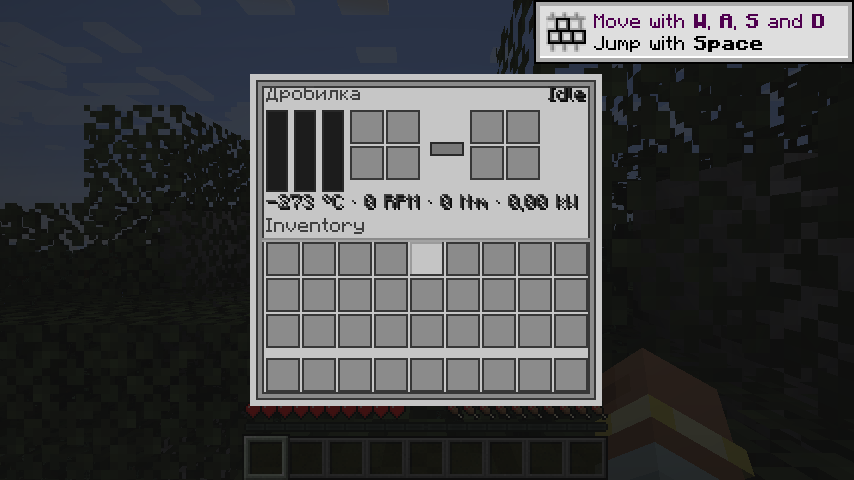

# Тесты и проверки

## Быстрый старт

```powershell
powershell -NoProfile -ExecutionPolicy Bypass -File tools\run_tests_offline.ps1
```

Ожидаемый хвост вывода:

```
[        34 tests successful      ]
[         0 tests failed          ]

tests: 34 ok, 0 failed
```

Скрипт сам находит jar'ы JUnit в кэше Gradle, компилирует `src/test/java` с основным
класс-пасом и запускает `TfTestRunner` (JUnit Platform Launcher). Требуется, чтобы
основной код был уже скомпилирован:

```bash
gradle --offline compileJava processResources
```

В окружении с сетью работает обычный путь: `gradle test`.

## Почему офлайн-раннер

`gradle test` в этой среде падает на этапе разрешения зависимостей:

```
Could not resolve org.junit.jupiter:junit-jupiter:5.11.4
No cached version available for offline mode
```

Jar'ы JUnit в кэше есть (их тянет сам NeoForge), но модульных метаданных нет, и Gradle
считает артефакт неразрешённым. Поэтому координаты в `build.gradle` оставлены для
нормальной сборки, а здесь тесты идут через `javac` + `junit-platform-launcher` напрямую.
Это тот же JUnit, тот же набор тестов, только без Gradle между ними.

## Что покрыто (34 теста)

| Класс | Тестов | О чём |
| --- | --- | --- |
| `core/util/UnitsTest` | 6 | FE ↔ джоуль (округление вниз, энергия не создаётся), P = (2π·RPM/60)·M и обратные, RPM ↔ рад/с, °C ↔ K, `clamp`/`clampLerp`, константы |
| `core/api/energy/EnergyStorageTest` | 6 | приём/отдача с ограничениями, чистота `simulate`, `getOutputPowerWatts`, отказ от отрицательных значений, 1 кВт·ч = 3.6 МДж = 1 440 000 FE |
| `core/api/heat/HeatStorageTest` | 8 | Q = C·ΔT, нижняя граница 293.15 K, верхний предел, остывание `h·ΔT/20`, `setTemperature` с клампом, лимиты печей 1573.15 / 1773.15 K |
| `balance/ProductionBalanceTest` | 8 | средний выход 1.8 куска, бронза с чанка ≈ 64, чугун ≈ 37, кислота ≈ 26 л, пропускная способность обогащения, 150 кДж на концентрат, время бронзовой линии, видимые потери 0.9 |
| `data/DataPackIntegrityTest` | 6 | типы рецептов против известных, ключи lang для исследований и предметов, разрешимость тегов, `counts.size() == ingredients.size()`, 162 породы + 167 фич, паритет ru/en, 18 звуковых событий, главы руководства |

Все тесты чистые: без Minecraft-рантайма, без сетевых вызовов, время прогона — доли секунды.

## Скрипты аудита

```bash
python tools/generate_data.py       # перегенерация рецептов/тегов/lang/моделей/worldgen
python tools/validate_data.py       # ссылочная целостность датапака
python tools/audit_resources.py     # id, зарегистрированные в Java, против файлов ресурсов
python tools/repair_text_encoding.py --check   # битая кодировка в исходниках и данных
python tools/gen_docs.py            # обновление docs/machines.md и docs/progression.md
```

* `validate_data.py` печатает итог вида
  `предметов: 438, тегов мода: 61, исследований: 58, типов рецептов: 44` и проверяет,
  что каждый рецепт ссылается на существующие предметы, теги и узлы исследований.
* `audit_resources.py` ловит расхождение «зарегистрировано в Java, но нет модели/текстуры»
  и наоборот; ожидаемый вывод — `расхождений нет`.
* `repair_text_encoding.py` ищет классическую порчу UTF-8 → cp1251 → UTF-8. Если файлы
  чистые, он так и говорит; правит только реальные случаи, себя не трогает.

## Запуск игры

Юнит-тесты не заменяют игру: регистрации, worldgen и экраны проверяются запуском.

```bash
gradle --offline runClient          # клиент: осмотреть породы, машины, GUI, руководство
gradle --offline runClientSmoke     # авто-смоук экранов руководства и исследований
gradle --offline runServer          # сервер: /reload, датапак, гейтинг рецептов
gradle --offline runGameTestServer  # сервер тестов (конфиг уже объявлен в build.gradle)
gradle --offline runData            # перегенерация данных провайдерами
```

Авто-смоук экранов: `client/GuiSmokeHook.java` заходит в тестовый мир `tfsmoke`, открывает
в живом клиенте руководство, древо исследований и GUI дробилки (по 20 тиков на экран), снимает
`run/screenshots/terrafabrica_{guide,research,machine}.png` и выходит. Включается только
системным свойством `-Dterrafabrica.guismoke=true`, которое выставляет запуск `runClientSmoke`,
поэтому в обычной игре хук ничего не делает. Этим смоуком найдена ошибка, которую не видит ни
один другой тест: экран исследований рисовал панель до `super.render` и оставался
ванильно-серым (в 1.21.1 `Screen.render` сам вызывает `renderBackground`). Для экрана машины
хук дополнительно печатает координаты панели, признак «панель целиком на экране» и координаты
всех 44 слотов — по этим числам баг «GUI поехал» виден без разглядывания картинки.

Снимки последнего прогона лежат в репозитории — это и есть проверка «экраны рисуют свои
панели»:







Ручной чек-лист в мире:

1. `/give` себе руководство (или скрафтить) — открывается экран с главами, листается мышью
   и стрелками, кнопка «Исследования» ведёт в дерево.
2. Найти породу: три категории богатства, камень и глубинный сланец, дроп 1/2/3 куска,
   шёлковое касание даёт блок.
3. Дробилка и сепаратор: 1 → 1 и 2 → 1, энергия списывается в джоулях, статус меняется.
4. Заблокированный рецепт: машина пишет «Нужно исследование» и не запускается.
5. Домница: медь, бронза 9:1, чугун из двух концентратов.
6. Привод: водяное колесо в потоке, вал, редуктор, станок — обороты и мощность в GUI.
7. `/reload` с изменённым рецептом — изменения подхватываются без перезапуска.

## Игровые тесты (GameTest)

`gradle --offline runGameTestServer` поднимает настоящий сервер, ставит блоки в мире и
тикает их по-настоящему — это единственный способ поймать ошибки, которые не видны
ни юнит-тестам, ни аудиту ресурсов (именно так были найдены четыре ошибки: см.
`docs/decisions.md`, раздел «Найдено запуском в мире»).

Класс `com.terrafabrica.gametest.TFGameTests`, шаблон структуры —
`data/terrafabrica/structure/test_platform.nbt` (платформа 5×5 из камня, генерируется
`tools/gen_test_structure.py`). Тесты:

| Тест | Что проверяет |
| --- | --- |
| `porodesRegistered` | 162 породы, 27 минералов, у каждой есть блок и предмет |
| `poorPorodeDropsOneRock` | дроп бедной жилы = ровно 1 кусок породы, без Silk Touch блока в дропе |
| `crusherProducesPowder` | дробилка за 100 тиков: кусок → порошок, вход израсходован, энергия списана |
| `separatorConsumesPowders` | сепаратор забирает 2 порошка за цикл и завершает цикл |
| `enrichmentItemsRegistered` | `*_rock`, `*_powder`, `*_concentrate` зарегистрированы как предметы |
| `researchGatingWorks` | узел закрыт по умолчанию, открывается прогрессом, без игрока гейтинг не блокирует |
| `worldgenPlacesPorodes` | форсированная загрузка 3×3 чанков и подсчёт пород в секциях |

Ожидаемый вывод в логе: `All 7 required tests passed :)`.

**Мир GameTest плоский (суперплоскость без камня), поэтому worldgen там проверить нельзя.**
`worldgenPlacesPorodes` честно измеряет это: если в загруженных чанках нет ни камня, ни
сланца, тест пишет `[gametest] в загруженных чанках нет камня … worldgen проверяется на
runServer` и завершается успешно. Реальная проверка пород — только на выделенном сервере
(следующий раздел).

## Проверка worldgen на выделенном сервере

GameTest этого не покрывает, поэтому породы проверяются на настоящем мире с настоящей
генерацией. Один раз настраиваем `run/` (EULA, RCON) и дальше повторяем:

```powershell
# 1. поднять сервер (в фоне), ждать "Done (...)! For help"
gradle --offline runServer

# 2. прогрузить площадь: 4 × forceload по 256 чанков
python tools\rcon.py 25577 terrafabrica "forceload add -256 -256 -1 -1"
python tools\rcon.py 25577 terrafabrica "save-all flush"

# 3. посчитать реальные блоки (NBT + распаковка палитр, не просто поиск строк)
python tools\count_blocks.py "run/worldgen_check"

# 4. погасить сервер
python tools\rcon.py 25577 terrafabrica "stop"
```

`tools/count_blocks.py` печатает распределение богатства — оно должно совпадать с
требованием 30/60/10. Замер на 1283 чанках (финальная сборка):

```
чанков: 1283, блоков посчитано: 126124032
пород: 2809140
  poor  :  844613 ( 30.1 %)
  normal: 1682299 ( 59.9 %)
  rich  :  282228 ( 10.0 %)
минералов: 27
```

`tools/scan_world.py` — быстрый вариант (ищет id в палитрах секций, без количеств):
годится, чтобы за секунды ответить «породы вообще есть или нет».

## GUI машин: три уровня проверки

Баг «GUI машин поехал, он за экраном наполовину» пришёл от игрока, а не от тестов, поэтому
проверок стало три:

1. `MachineLayoutTest` — чистая арифметика раскладки без Minecraft: слоты не совпадают по
   координатам, влезают в панель с полями, не налезают на полосы/стрелку/инвентарь, панель
   не больше ванильной 176x166.
2. `MachinePanelTextureTest` — читает `textures/gui/machine.png` через `ImageIO` и сверяет
   размер и позиции рамок слотов с `MachineLayout`. Ловит рассинхрон «код поправили,
   текстуру забыли перегенерировать».
3. Скриншот смоука `runClientSmoke` — единственное, что проверяет *фактическую* отрисовку.
   Хук пишет в лог координаты панели, признак «панель целиком на экране: да/НЕТ» и координаты
   всех 44 слотов, а скриншот лежит в `run/screenshots/terrafabrica_machine.png`.
   Числа сравниваются с рамками в текстуре попиксельно:

```powershell
# панель должна совпасть с текстурой почти полностью (>95 %), слоты — стоять в рамках
python - <<'PY'
from PIL import Image
shot = Image.open('run/screenshots/terrafabrica_machine.png').convert('RGB')
tex = Image.open('src/main/resources/assets/terrafabrica/textures/gui/machine.png').convert('RGB')
...
PY
```

Ровно так и нашлась настоящая причина: панель рисовалась короткой перегрузкой `blit`,
которая считает текстуру 256x256, поэтому изображение растягивалось в 1,45x1,54 и совпадение
с текстурой было 30 %, а не 96 %. Глазами это выглядело как «половина GUI за экраном».

## Чего в тестах нет

* Красота экранов: смоук доказывает, что экраны открываются, панель на экране и содержимое
  совпадает с текстурой, но не оценивает оформление. Анимации блоков и HUD — только глазами.
* Поведение при произвольном масштабе интерфейса: смоук идёт при масштабе 2 (окно 854x480).
  Панель ванильного размера влезает везде, где влезает инвентарь, но масштаб 3 на окне
  ниже 500 пикселей проверяется только вручную.
* Совместимость с другими модами — мод не использует ничего, кроме NeoForge, но проверялся
  только в чистой сборке.
